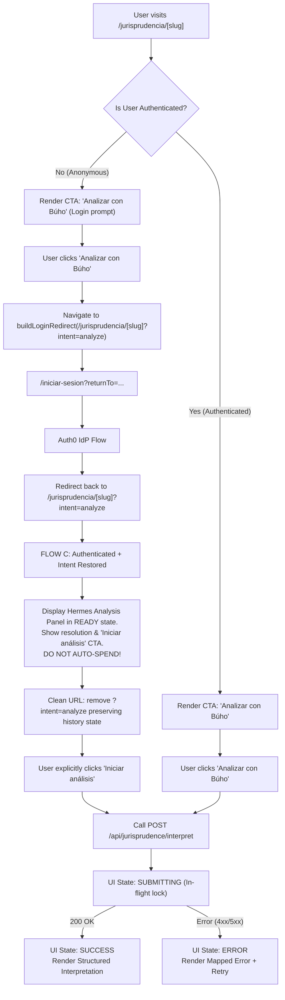

# HERMES-PROD-A2.5-DESIGN
ARCHITECTURAL AUDIT & FRONTEND ENTRY DESIGN: PUBLIC JURISPRUDENCE DETAIL → "ANALIZAR CON BÚHO"
DOCUMENTATION ONLY — NO IMPLEMENTATION IN THIS PHASE

---

## 1. Executive Summary & Design Identity

- **Document Identifier**: `HERMES-PROD-A2.5-DESIGN`
- **Scope**: Audit frontend, auth, and HTTP architecture; design the first real user-facing entry point for Hermes jurisprudence analysis from the public detail page `/jurisprudencia/[slug]`.
- **Target Action**: "Analizar con Búho" (Analyze with Búho)
- **Status**: `DESIGN / AUDIT ONLY` (Zero implementation, zero provider calls, zero database mutations).
- **Target Repository**: `C:\Projects\Buholex-rev\WebBuholex`
- **Baseline Git HEAD**: `c423c841cbb599d8cbb260931621bfe0fce9bdac`
- **Governing Freezes**:
  - [`docs/hermes/HERMES-PROD-A2-FREEZE.md`](file:///c:/Projects/Buholex-rev/WebBuholex/docs/hermes/HERMES-PROD-A2-FREEZE.md) (Core, Orchestrator, Grounding, Roles, HTTP Endpoint)
  - [`docs/hermes/HERMES-PROD-A2.4-FREEZE.md`](file:///c:/Projects/Buholex-rev/WebBuholex/docs/hermes/HERMES-PROD-A2.4-FREEZE.md) (Safe `returnTo` + `intent=analyze` boundary)

---

## 2. Audited Current Architecture

### 2.1 Public Detail Page Route & Data Path
- **Route file**: [`app/jurisprudencia/[slug]/page.tsx`](file:///c:/Projects/Buholex-rev/WebBuholex/app/jurisprudencia/[slug]/page.tsx)
  - Type: **Server Component** (async function `JurisprudenceDetailPage({ params, searchParams })`).
  - Next.js 15 asynchronous param contract: `await params`, `await searchParams`.
  - Generates SEO metadata dynamically via `generateMetadata`.
  - Renders `<JurisprudencePublicDetail>` passing `slug`, `getBySlugAction={getJurisprudencePublicBySlugAction}`, and `rawSearchParams={resolvedSearchParams}`.
- **Client Component**: [`components/jurisprudence/jurisprudence-public-detail.tsx`](file:///c:/Projects/Buholex-rev/WebBuholex/components/jurisprudence/jurisprudence-public-detail.tsx)
  - Declared with `"use client"`.
  - Manages view states: `invalid_slug`, `loading`, `success`, `not_found`, `not_configured`, `controlled_error`.
  - Fetches data inside `useEffect` on mount using the supplied Server Action or gateway.
- **Data Loader**: [`lib/jurisprudence/postgres-jurisprudence-public-actions.ts`](file:///c:/Projects/Buholex-rev/WebBuholex/lib/jurisprudence/postgres-jurisprudence-public-actions.ts)
  - Server Action `getJurisprudencePublicBySlugAction(slug)`.
  - Validates `slug` with `jurisprudencePublicSlugSchema`.
  - Queries `PostgresJurisprudencePublicReadRepository.getBySlug()`.
- **Read Repository**: [`lib/jurisprudence/postgres-jurisprudence-public-read-repository.ts`](file:///c:/Projects/Buholex-rev/WebBuholex/lib/jurisprudence/postgres-jurisprudence-public-read-repository.ts)
  - Executes exclusively against `jurisprudencePublishedRecords` in the `jurisprudence_public` schema.
  - Uses `withJurisprudencePublicReadRole` (`SET LOCAL ROLE jurisprudence_public_read_runtime`).
  - Never touches private internal tables (`jurisprudence_records`).
- **DTO Types & Schemas**:
  - `JurisprudencePublicProjectionDetail` in [`types/jurisprudence.ts`](file:///c:/Projects/Buholex-rev/WebBuholex/types/jurisprudence.ts).
  - `jurisprudencePublicSlugSchema` in [`lib/schemas/jurisprudence-public-search-gateway.ts`](file:///c:/Projects/Buholex-rev/WebBuholex/lib/schemas/jurisprudence-public-search-gateway.ts).

### 2.2 Current Public Detail UI Sections
The public detail page currently renders three main sections:
1. **Hero Header** (`styles.hero`):
   - Accessible back link: `← Volver a la búsqueda` (preserves sanitized catalog query params).
   - Category tracker: `DETALLE JURISPRUDENCIAL`.
   - Title: `h1` (`caseTitle` or fallback).
   - Institution & Issuing Body: `h2` (`institutionName · issuingBody`).
2. **Structured Information Article** (`styles.searchSection` / `styles.detailArticle`):
   - Metadata definition grid (`dl.detailGrid`): Institución, Órgano emisor, Título, Expediente, Resolución, Tipo, Materia, Fecha de emisión, Identificador público (slug), Fuente pública.
   - Resumen estructurado (`div.detailSummary`): Textual summary (`summary`).
   - Enlaces oficiales (`div.officialLinksContainer`): "Ver fuente oficial" (HTML) and "Ver PDF oficial" (PDF), rendered safely with `target="_blank"` and `rel="noopener noreferrer"`.
3. **Public Disclaimer** (`styles.publicNotice`):
   - Informs users that information is strictly informative and does not constitute legal counsel or automatic applicability.

### 2.3 Audit of Existing Analysis CTAs
- **On `/jurisprudencia/[slug]`**: There is **no** existing CTA for "Analizar con Búho", "Analizar una sentencia", "Comparar", or "Evaluar aplicabilidad".
- **On `/jurisprudencia` (Catalog Index)**:
  - Lines 90–96 of [`components/jurisprudence/jurisprudence-public-page.tsx`](file:///c:/Projects/Buholex-rev/WebBuholex/components/jurisprudence/jurisprudence-public-page.tsx) contain informational links: `["Analizar una sentencia", "Comparar resoluciones", "Preguntar al Asistente", "Evaluar aplicabilidad"]`, all currently pointing to `/iniciar-sesion/`.
  - Preview components [`components/jurisprudence/intelligent-space-jurisprudence.tsx`](file:///c:/Projects/Buholex-rev/WebBuholex/components/jurisprudence/intelligent-space-jurisprudence.tsx) and [`components/jurisprudence/jurisprudence-assisted-demo.tsx`](file:///c:/Projects/Buholex-rev/WebBuholex/components/jurisprudence/jurisprudence-assisted-demo.tsx) render disabled/mock tabs marked "Próximamente".
- **Finding**: `/jurisprudencia/[slug]` is a clean canvas for mounting the first real Hermes entry point.

---

## 3. Exact File Ownership Map

| Responsibility | Owning File | Component / Handler Type |
|---|---|---|
| **Public Route Entry** | [`app/jurisprudencia/[slug]/page.tsx`](file:///c:/Projects/Buholex-rev/WebBuholex/app/jurisprudencia/[slug]/page.tsx) | Server Component |
| **Public Detail View** | [`components/jurisprudence/jurisprudence-public-detail.tsx`](file:///c:/Projects/Buholex-rev/WebBuholex/components/jurisprudence/jurisprudence-public-detail.tsx) | Client Component (`"use client"`) |
| **Public Detail Data Loader** | [`lib/jurisprudence/postgres-jurisprudence-public-actions.ts`](file:///c:/Projects/Buholex-rev/WebBuholex/lib/jurisprudence/postgres-jurisprudence-public-actions.ts) | Server Action (`"use server"`) |
| **Hermes Analysis Entry (Future)** | `components/jurisprudence/jurisprudence-analysis-panel.tsx` | Client Component (Recommended) |
| **Hermes Result View (Future)** | `components/jurisprudence/jurisprudence-interpretation-view.tsx` | Presentational Component |
| **Hermes HTTP Route** | [`app/api/jurisprudence/interpret/route.ts`](file:///c:/Projects/Buholex-rev/WebBuholex/app/api/jurisprudence/interpret/route.ts) | Next.js Route Handler (`POST`) |
| **Hermes HTTP Handler** | [`lib/jurisprudence/jurisprudence-interpret-http-handler.ts`](file:///c:/Projects/Buholex-rev/WebBuholex/lib/jurisprudence/jurisprudence-interpret-http-handler.ts) | Server-only handler |
| **Public Slug Resolver** | [`lib/jurisprudence/jurisprudence-public-slug-resolver.ts`](file:///c:/Projects/Buholex-rev/WebBuholex/lib/jurisprudence/jurisprudence-public-slug-resolver.ts) | Server-only resolver |
| **Auth Session Service** | [`lib/auth/session.ts`](file:///c:/Projects/Buholex-rev/WebBuholex/lib/auth/session.ts) | Server-only helper |
| **Auth0 Client** | [`lib/auth/auth0.ts`](file:///c:/Projects/Buholex-rev/WebBuholex/lib/auth/auth0.ts) | Server-only Auth0 client |
| **ReturnTo & Login Paths** | [`lib/auth/return-to.ts`](file:///c:/Projects/Buholex-rev/WebBuholex/lib/auth/return-to.ts) | Pure utility |
| **App Login Gateway** | [`app/iniciar-sesion/page.tsx`](file:///c:/Projects/Buholex-rev/WebBuholex/app/iniciar-sesion/page.tsx) | Server Component |
| **Edge Middleware** | [`middleware.ts`](file:///c:/Projects/Buholex-rev/WebBuholex/middleware.ts) | Edge Middleware |

---

## 4. Authentication State Availability Audit

### 4.1 Server-Side Session Availability (`getWorkspaceSession`)
- **Function**: `getWorkspaceSession()` in [`lib/auth/session.ts`](file:///c:/Projects/Buholex-rev/WebBuholex/lib/auth/session.ts).
- **Return Type**: `Promise<WorkspaceSession>`:
  ```ts
  interface WorkspaceSession {
    status: "authenticated" | "unauthenticated" | "loading" | "not_configured";
    sessionId: string | null;
    providerSubjectId: string | null;
    issuedAt: string | null;
    expiresAt: string | null;
    provider: "auth0" | null;
  }
  ```
- **Execution in Server Component**:
  - `getWorkspaceSession()` can be safely called from [`app/jurisprudencia/[slug]/page.tsx`](file:///c:/Projects/Buholex-rev/WebBuholex/app/jurisprudencia/[slug]/page.tsx).
  - It invokes `auth0.getSession()`. If anonymous, it resolves cleanly to `{ status: "not_configured", ... }` without throwing.
  - **Dynamic Rendering Impact**: Reading cookies via `@auth0/nextjs-auth0/server` marks a route as dynamically rendered at request time. However, `/jurisprudencia/[slug]` already awaits `searchParams` and lacks `generateStaticParams`, so it is **already** dynamically rendered per request. Calling `getWorkspaceSession()` does not introduce new de-optimizations.
  - **Information Boundary**: The Server Component must extract only `const isAuthenticated = session.status === "authenticated"` and pass **only** this boolean down to client components. `sessionId`, `providerSubjectId`, and tokens must **never** be passed down to public client props.

### 4.2 Middleware Boundary
- [`middleware.ts`](file:///c:/Projects/Buholex-rev/WebBuholex/middleware.ts) evaluates authorization guards **only** on paths starting with `/app`.
- Public routes (`/jurisprudencia/*`) pass through the middleware without redirection, while still running `auth0.middleware(request)` for rolling session cookies.
- **Rule**: `middleware.ts` must remain untouched.

### 4.3 Client-Side Auth Hook Audit
- Grep audit confirmed that `@auth0/nextjs-auth0/client` hooks (`useUser`, etc.) are **not** used or configured in the repository.
- Therefore, client components must not rely on client-side auth context hooks. Passing `isAuthenticated: boolean` from the Server Component or discovering authentication via the HTTP endpoint (401 response) is the repo pattern.

---

## 5. ReturnTo / Intent Contract Confirmation

The contract frozen in `HERMES-PROD-A2.4` was verified with 0 drift:

1. **Unauthenticated Intent URL**:
   `/jurisprudencia/<slug>?intent=analyze`
2. **App Login Redirect**:
   `buildLoginRedirect('/jurisprudencia/<slug>?intent=analyze')` → `/iniciar-sesion?returnTo=%2Fjurisprudencia%2F<slug>%3Fintent%3Danalyze`
3. **Auth0 Login Path**:
   `buildAuth0LoginPath('/jurisprudencia/<slug>?intent=analyze')` → `/auth/login?returnTo=%2Fjurisprudencia%2F<slug>%3Fintent%3Danalyze`
4. **Validation Rules**:
   - Slug must strictly satisfy `jurisprudencePublicSlugSchema` (`^[a-z0-9]+(?:-[a-z0-9]+)*$`).
   - Query must strictly equal `?intent=analyze`.
   - Any canonical ID (`recordId`, `recordVersion`, `canonicalId`), extra query param, duplicate intent, or fragment (`#`) fails closed to `/app`.
   - Zero canonical IDs are leaked into URLs.

---

## 6. Audit of Existing Hermes HTTP Client Surface

### 6.1 Existing Client Request Patterns
Audited client components that perform mutations or POST requests:
- [`components/owl/owl-analysis-entry.tsx`](file:///c:/Projects/Buholex-rev/WebBuholex/components/owl/owl-analysis-entry.tsx): Uses direct `fetch("/api/owl/admission", { method: "POST", headers: { "Content-Type": "application/json" }, body: JSON.stringify(...) })`. Uses `AbortController`, `isSubmitting` state, and status-code based error branching.
- [`components/workspace/admin-complaint-review-action.tsx`](file:///c:/Projects/Buholex-rev/WebBuholex/components/workspace/admin-complaint-review-action.tsx): Uses direct `fetch("/api/admin/complaints/.../review", { method: "POST", ... })`. Checks `response.status` (401, 403, 404, 409, 503) and displays user-friendly Spanish error messages.
- [`components/payments/operator-token-harness.tsx`](file:///c:/Projects/Buholex-rev/WebBuholex/components/payments/operator-token-harness.tsx): Uses direct `fetch` with JSON envelope and loading flags.

### 6.2 Test Barrier Alert (Phase 11.O Test 14)
- Test [`tests/phase-11-o-jurisprudence-public-detail-experience.test.tsx`](file:///c:/Projects/Buholex-rev/WebBuholex/tests/phase-11-o-jurisprudence-public-detail-experience.test.tsx) contains a strict static source assertion:
  ```ts
  it("14. la UI no importa repositorios, SQLite ni servicios internos", async () => {
    const files = [
      "app/jurisprudencia/[slug]/page.tsx",
      "components/jurisprudence/jurisprudence-public-detail.tsx",
      "components/jurisprudence/jurisprudence-public-search.tsx",
    ];
    // ...
    expect(source).not.toMatch(/fetch\s*\(/);
  });
  ```
- **Architectural Consequence**: `components/jurisprudence/jurisprudence-public-detail.tsx` must **NOT** contain a direct `fetch(` call!
- **Solution**: The Hermes analysis interaction, state machine, and `fetch` call must be housed inside a dedicated child component (e.g., `components/jurisprudence/jurisprudence-analysis-panel.tsx`). `JurisprudencePublicDetail` will simply compose this child component. This honors Phase 11.O static boundaries completely while maintaining modularity.

---

## 7. Interpretation Response Contract Audit

### 7.1 Backend Frozen Contract (`POST /api/jurisprudence/interpret`)
- **Request**:
  ```json
  {
    "slug": "exp-00123-2024-aa-tc"
  }
  ```
- **Success Response (`200 OK`)**:
  ```json
  {
    "ok": true,
    "data": {
      "slug": "exp-00123-2024-aa-tc",
      "interpretation": {
        "summary": "...",
        "legalMatter": "...",
        "legalIssues": ["..."],
        "ratioDecidendi": {
          "status": "identified",
          "text": "...",
          "support": [{ "quote": "...", "paragraphReference": "...", "pageReference": "..." }]
        },
        "obiterDicta": [{ "text": "...", "support": [...] }],
        "citedNorms": [{ "reference": "...", "support": [...] }],
        "citedPrecedents": [{ "reference": "...", "support": [...] }],
        "keyCriteria": ["..."],
        "scope": "...",
        "limitations": "...",
        "citations": [{ "quote": "...", "paragraphReference": "...", "pageReference": "..." }],
        "verificationStatus": "machine_generated_unverified"
      }
    }
  }
  ```
- **Invariants**:
  - Response never exposes `recordId`, `recordVersion`, `canonicalId`, or diagnostic internals.
  - Verification status is fixed to `"machine_generated_unverified"`.

### 7.2 Exhaustive Backend Error Codes
Extracted directly from [`lib/jurisprudence/jurisprudence-interpret-http-handler.ts`](file:///c:/Projects/Buholex-rev/WebBuholex/lib/jurisprudence/jurisprudence-interpret-http-handler.ts):

| Status | Error Code | Backend Message | Cause |
|---|---|---|---|
| `401` | `authentication_required` | Debes iniciar sesión para utilizar esta función. | Session missing or unauthenticated. |
| `400` | `invalid_request_schema` | El formato de los parámetros de solicitud es inválido. | Body not strictly `{ slug }`. |
| `400` | `malformed_json` | Se requiere un cuerpo JSON en la solicitud. | Invalid JSON body. |
| `403` | `origin_not_allowed` | Origen de solicitud no autorizado. | Origin header does not match host. |
| `404` | `jurisprudence_not_found` | No se encontró una resolución pública disponible para análisis. | Slug not published or withdrawn. |
| `409` | `record_version_mismatch` | La versión del registro solicitada no coincide... | Canonical version mismatch. |
| `413` | `payload_too_large` | El cuerpo de la solicitud supera el tamaño máximo permitido. | Request exceeds 2048 bytes. |
| `415` | `unsupported_media_type` | Se requiere Content-Type application/json. | Missing/invalid Content-Type. |
| `422` | `grounding_failed` | La interpretación no pudo ser respaldada con citas exactas... | Verbatim citation check failed. |
| `422` | `source_too_large` | El texto canónico del registro supera el límite... | Source text > 100,000 chars. |
| `429` | `rate_limited` | Ha excedido el límite de solicitudes... | Subject or global bucket full (`Retry-After` present). |
| `502` | `provider_failure` | El proveedor de análisis presentó una falla temporal. | OpenAI failure / network error. |
| `502` | `invalid_interpretation` | La interpretación obtenida no cumple con la estructura... | Provider output failed Zod schema. |
| `503` | `limiter_unavailable` | El servicio de limitación de tasa no está disponible. | Database failure in limiter. |
| `500` | `unexpected_internal_failure` | Ocurrió un error inesperado al procesar la solicitud. | Unhandled panic/error. |

---

## 8. Client vs Server Execution Design

### 8.1 Comparison of Options

#### Option A: Client Component calls `POST /api/jurisprudence/interpret` via `fetch`
- **Auth Boundary**: Handled cleanly. Browser sends session cookies automatically. Endpoint validates session via `getWorkspaceSession()` and returns 401 if missing/expired.
- **CSRF / Origin Handling**: Browser sets standard `Origin` header. Route handler's `validateOrigin()` checks origin matches host.
- **Rate Limiting**: Real client IP is preserved in `x-forwarded-for` / request headers; HMAC rate limiting operates as designed.
- **Loading & Retry UX**: Native React state (`idle`, `submitting`, `success`, `error`) enables smooth spinners, disable locks, cancellation via `AbortController`, and retry buttons with countdown timers from `Retry-After`.
- **Response Streaming / Polling**: Standard HTTP pipeline ready for future streaming or progress events without architectural rewrites.
- **Page Performance**: Public page renders immediately with basic jurisprudence information; heavy LLM work only happens on-demand when requested.

#### Option B: Server Action wraps internal HTTP request or runtime
- **Drawbacks**: Next.js Server Actions calling internal HTTP routes have origin header complications, port resolution issues, and loopback latency. If bypassing the HTTP route and calling orchestrator directly, it would duplicate or bypass rate limiting, origin checks, and body size guards.

#### Option C: Server Component triggers orchestration on page render
- **Severe Hazards**:
  - Automatically executes expensive OpenAI LLM calls on every page load or crawler visit.
  - Zero cost control.
  - Blocks page rendering for 15–30 seconds.
  - Violates duplicate call protections on reload.

### 8.2 Explicit Recommendation
**Recommendation: OPTION A (Client Component calling `POST /api/jurisprudence/interpret`).**
Encapsulated in a dedicated child component (`components/jurisprudence/jurisprudence-analysis-panel.tsx`) to strictly respect test 14 of `phase-11-o`.

---

## 9. Design of User Flows



### 9.1 Flow A — Public / Not Authenticated
1. User visits `/jurisprudencia/<slug>`.
2. Page identifies `isAuthenticated === false`.
3. CTA button displays: **"Analizar con Búho"** (with secondary helper: *"Inicia sesión para generar un análisis jurídico estructurado"*).
4. User clicks the CTA.
5. Frontend navigates to `buildLoginRedirect('/jurisprudencia/' + slug + '?intent=analyze')`.
6. User lands on `/iniciar-sesion?returnTo=%2Fjurisprudencia%2F<slug>%3Fintent%3Danalyze`.
7. User clicks "Iniciar sesión" linking to `buildAuth0LoginPath(...)`.
8. User authenticates via Auth0 and is returned to `/jurisprudencia/<slug>?intent=analyze`.

### 9.2 Flow B — Authenticated (Direct on Page)
1. User visits `/jurisprudencia/<slug>` while already logged in.
2. Page identifies `isAuthenticated === true`.
3. User clicks **"Analizar con Búho"**.
4. The analysis panel transitions to `submitting` with an active submission lock (or reveals the pre-flight confirmation card).
5. Frontend sends `POST /api/jurisprudence/interpret` with `{ "slug": slug }`.
6. Upon completion, transitions to `success` or `error`.

### 9.3 Flow C — Authenticated + Returned with Intent
1. User lands at `/jurisprudencia/<slug>?intent=analyze` after completing login.
2. **OPTION 2 (MANDATORY)**: The UI opens the Hermes Analysis Panel in a `ready` / `intent_restored` state, and **requires ONE explicit user click ("Iniciar análisis con Búho")** before calling the provider.
3. **Strict Evaluation of Option 1 (Auto-trigger) vs Option 2 (Explicit Click)**:
   - *Accidental Paid Invocation*: Auto-triggering would spend LLM credits if a user opened several tabs or bookmarked the URL.
   - *Reload / Refresh Hazard*: Pressing F5 on `/jurisprudencia/<slug>?intent=analyze` would trigger repeated paid model executions.
   - *Browser Back/Forward*: Returning to the page from browser history would trigger unexpected expenditure.
   - *Quota / Cost Pre-Flight*: Future phases will require quota/credit confirmation before spending. Option 2 establishes this boundary naturally.
   - *Safe URL Hygiene*: Once the panel is mounted in `ready` state, the client immediately cleans the intent parameter without clobbering framework/router history state or triggering extra navigation. Conceptually:
     ```ts
     window.history.replaceState(
       window.history.state,
       "",
       `/jurisprudencia/${slug}`
     );
     ```
     Preserving `window.history.state` ensures router history metadata is not clobbered (prescribing `{}` as history state is strictly prohibited). The cleanup must:
     - remove exclusively `intent=analyze`;
     - not trigger an automatic analysis or provider call;
     - not trigger an extra navigation loop or re-render cascade;
     - preserve the canonical `/jurisprudencia/<slug>` path;
     - preserve normal browser back/forward (BFCache) navigation.
4. **Verdict**: **Auto-trigger is STRICTLY PROHIBITED. Explicit user confirmation is REQUIRED.**

---

## 10. UI State Machine Design

The client-side interaction is governed by a finite state machine:

```
               [ unauthenticated click ]
        +-----------------------------------> [ auth_redirecting ]
        |
     [ idle ] <-----------------------+
        |                             |
        | [ return with intent=analyze]
        v                             | [ close / cancel ]
    [ ready ] ------------------------+
        |
        | [ click 'Iniciar análisis' (authenticated) ]
        v
  [ submitting ] (locked via inFlightRef, abortable)
        |
        +------> [ success ] (render interpretation)
        |
        +------> [ error ] -- [ retry ] --> [ submitting ]
```

### 10.1 Explicit State Definitions
```ts
type HermesUiState =
  | { readonly kind: "idle" }
  | { readonly kind: "auth_redirecting"; readonly loginUrl: string }
  | { readonly kind: "ready" }
  | { readonly kind: "submitting" }
  | { readonly kind: "success"; readonly interpretation: JurisprudenceInterpretation }
  | { readonly kind: "error"; readonly errorKind: HermesErrorKind; readonly message: string; readonly retryAfterSeconds?: number };

type HermesErrorKind =
  | "auth_required"
  | "not_found"
  | "rate_limited"
  | "grounding_failed"
  | "source_too_large"
  | "provider_failure"
  | "service_unavailable"
  | "internal_error";
```

### 10.2 State Transitions
- **`idle` → `auth_redirecting`**: Triggered when `isAuthenticated === false` and user clicks CTA. Navigates to `buildLoginRedirect('/jurisprudencia/' + slug + '?intent=analyze')`.
- **`idle` → `ready`**: Triggered on page mount if `rawSearchParams.intent === "analyze"` and `isAuthenticated === true`.
- **`idle` → `submitting`**: Triggered when `isAuthenticated === true` and user clicks "Analizar con Búho" directly.
- **`ready` → `submitting`**: User clicks "Iniciar análisis con Búho".
- **`ready` → `idle`**: User clicks "Descartar" / "Cerrar panel".
- **`submitting` → `success`**: Endpoint returns HTTP `200` with valid `data.interpretation`.
- **`submitting` → `error`**: Endpoint returns non-200 or fetch fails (see Section 12).
- **`error` → `submitting`**: User clicks "Reintentar".
- **`error` → `idle`**: User clicks "Cerrar".

### 10.3 True Synchronous In-Flight Lock Architecture
React state (`isSubmitting`) is scheduled asynchronously by the React runtime and cannot serve as the authoritative synchronous lock against double-clicks or same-tick event bursts.

The implementation must enforce an imperative synchronous lock via a dedicated mutable ref:

```ts
// Component instance refs (imperative boundaries)
const inFlightRef = useRef(false);
const abortRef = useRef<AbortController | null>(null);

const handleStartAnalysis = async () => {
  // 1. Authoritative synchronous lock check BEFORE first await or tick
  if (inFlightRef.current) return;
  inFlightRef.current = true;

  // 2. Abort prior in-flight request if any & instantiate new AbortController
  abortRef.current?.abort();
  const controller = new AbortController();
  abortRef.current = controller;

  // 3. Update React rendering state for visual loading/spinner indicators
  setUiState({ kind: "submitting" });

  try {
    const response = await fetch("/api/jurisprudence/interpret", {
      method: "POST",
      headers: { "Content-Type": "application/json" },
      body: JSON.stringify({ slug }),
      signal: controller.signal,
      cache: "no-store",
    });

    // ... process response ...
  } catch (err) {
    // ... handle errors ...
  } finally {
    // 4. Release authoritative synchronous lock in finally block
    inFlightRef.current = false;
    if (abortRef.current === controller) {
      abortRef.current = null;
    }
  }
};
```

Key invariants:
- `inFlightRef.current = true` occurs synchronously before the first `await`.
- Any concurrent submission attempt in the same tick immediately returns with zero side effects.
- The lock is guaranteed to be released in `finally`.
- `AbortController` is held in `abortRef` rather than inside the React UI state machine payload, cleanly separating imperative execution control from declarative render state.

---

## 11. Result Presentation Design

The interpretation view must format the frozen data structure cleanly, maintaining legal integrity and clear separation of synthesis from evidence.

### 11.1 Structural Layout
```
+-------------------------------------------------------------------+
|  [!] AVISO: machine_generated_unverified                          |
|  "Síntesis asistida generada por inteligencia artificial.         |
|   No constituye asesoría jurídica ni opinión vinculante."          |
+-------------------------------------------------------------------+
|  1. SÍNTESIS EJECUTIVA                                            |
|     Materia: {legalMatter}                                        |
|     Resumen: {summary}                                            |
|     Problemas jurídicos:                                          |
|       - {legalIssues[0]}                                          |
|       - {legalIssues[1]}                                          |
+-------------------------------------------------------------------+
|  2. RATIO DECIDENDI ({ratioDecidendi.status})                     |
|     Texto: {ratioDecidendi.text}                                  |
|     +-----------------------------------------------------------+ |
|     | Sustento documental verbatim (Citas de respaldo):         | |
|     |  > "{support[0].quote}"                                   | |
|     |    (Ref: {paragraphReference}, {pageReference})           | |
|     +-----------------------------------------------------------+ |
+-------------------------------------------------------------------+
|  3. CRITERIOS CLAVE Y ALCANCE                                     |
|     Criterios:                                                    |
|       - {keyCriteria[0]}                                          |
|     Alcance: {scope}                                              |
|     Límites: {limitations}                                        |
+-------------------------------------------------------------------+
|  4. FUNDAMENTOS ACCESORIOS (OBITER DICTA)                         |
|     - {obiterDicta[0].text}                                       |
|       [+] Ver sustento verbatim ({obiterDicta[0].support.length}) |
+-------------------------------------------------------------------+
|  5. NORMAS Y PRECEDENTES CITADOS                                  |
|     Normas: {citedNorms[...].reference}                           |
|     Precedentes: {citedPrecedents[...].reference}                 |
+-------------------------------------------------------------------+
```

### 11.2 Key Presentation Invariants
1. **Mandatory Disclaimer**: Prominently display that the result is `machine_generated_unverified` with clear disclaimer that it does not replace judicial review or official sources.
2. **Visual Separation of Verbatim Quotes**: Synthetic text is displayed in standard typography. Grounded quotes (`support[].quote`, `citations[].quote`) are placed in distinct quote containers (serif, indented, border-left accent) displaying exact paragraph and page references.
3. **No Internal Canonical Identifiers**: `recordId`, `recordVersion`, and database keys must **never** appear in the DOM.
4. **Neutral AI Branding**: No external model names ("gpt-6.1-sol", "OpenAI") in the public UI. Branded consistently as "Búho Asistido" / "BúhoLex Hermes".

---

## 12. Error UX Mapping

| Backend Code | HTTP Status | User-Facing Message | User Action / UI Component |
|---|---|---|---|
| `authentication_required` | `401` | "Tu sesión ha expirado o necesitas iniciar sesión para continuar." | Button: "Iniciar sesión" (links to `buildLoginRedirect`) |
| `jurisprudence_not_found` | `404` | "Esta resolución no está disponible para análisis o no se encuentra publicada." | Informational badge + link back to search |
| `rate_limited` | `429` | "Has alcanzado el límite de solicitudes. Por favor espera {N} segundos." | Countdown timer; disabled retry button until timer reaches 0 |
| `grounding_failed` | `422` | "El análisis no pudo ser contrastado con suficiente respaldo textual en la resolución. Por rigor jurídico, no se emite una interpretación no fundamentada." | Button: "Reintentar análisis" |
| `source_too_large` | `422` | "El documento judicial excede la longitud máxima admitida para análisis directo." | Link: "Consultar PDF oficial" |
| `provider_failure` | `502` | "El motor de análisis presentó una falla temporal. Inténtalo nuevamente en unos momentos." | Button: "Reintentar" |
| `invalid_interpretation` | `502` | "La respuesta generada no cumplió los requisitos de validación estructural." | Button: "Reintentar" |
| `limiter_unavailable` | `503` | "El servicio de análisis se encuentra temporalmente no disponible. Inténtalo nuevamente más tarde." | Message: "Inténtalo más tarde" |
| `origin_not_allowed` | `403` | "Solicitud no permitida por política de seguridad del navegador." | Controlled alert |
| `unexpected_internal_failure` | `500` | "Ocurrió un error inesperado al procesar la resolución." | Button: "Reintentar más tarde" |
| *Network Drop / Abort* | *0* | "Se perdió la conexión con el servidor o la solicitud fue cancelada." | Button: "Reintentar" |

> [!IMPORTANT]
> **Strict UX Honesty Invariant**: The frontend must never promise "no charge", "refund", "credit restoration", or attribute backend limits to "maintenance" unless future billing, quota, and infrastructure phases explicitly prove and authorize those claims. User messages must remain strictly factual, neutral, and bounded to the verified error response.

---

## 13. Cost & Duplicate-Call Risk Mitigation

| Hazard | Risk Level | Mitigation Mechanism |
|---|---|---|
| **Query Intent Reload (F5)** | HIGH | Require explicit click in `ready` state; scrub `?intent=analyze` from URL preserving framework state (`window.history.state`) without triggering re-render cascades or navigation loops. |
| **React Strict Mode Remount** | HIGH | Zero calls in `useEffect`. Execution is strictly bound to user `onClick` events. |
| **Rapid Double Click / Same-Tick Bursts** | HIGH | Authoritative synchronous guard via `inFlightRef.current`: if `inFlightRef.current === true`, immediately return before any asynchronous gap or `await`. React state is used solely for visual button disablement. |
| **Multiple Submissions While Waiting** | MEDIUM | `inFlightRef` and `isSubmitting` maintain visual loading spinner and disable submit/retry triggers until promise settles. |
| **Browser Back/Forward (BFCache)** | MEDIUM | BFCache restores page in `idle` or `ready` state without re-triggering the click handler; preserving `window.history.state` ensures router history remains consistent. |
| **User Navigation / Tab Close** | LOW | Request is wired to `AbortController` in `abortRef`. Unmount triggers `abortRef.current?.abort()` to prevent unmounted component state updates. |
| **Crawlers / Pre-rendering** | HIGH | Route handler requires POST + authenticated session. Crawlers performing GET or unauthenticated requests are stopped with 405 or 401 before touching the resolver or rate limiter. |

---

## 14. Exact Future Changes & Protected Boundaries

### 14.1 Files Authorized to Change in Future Phase (A2.6)
1. [`app/jurisprudencia/[slug]/page.tsx`](file:///c:/Projects/Buholex-rev/WebBuholex/app/jurisprudencia/[slug]/page.tsx):
   - Call `const session = await getWorkspaceSession()`.
   - Pass `isAuthenticated={session.status === "authenticated"}` to client detail component.
2. [`components/jurisprudence/jurisprudence-public-detail.tsx`](file:///c:/Projects/Buholex-rev/WebBuholex/components/jurisprudence/jurisprudence-public-detail.tsx):
   - Accept `isAuthenticated?: boolean` prop.
   - Mount `<JurisprudenceAnalysisPanel slug={slug} isAuthenticated={isAuthenticated} ... />` inside the detail article (when in `success` state).
3. **New File**: `components/jurisprudence/jurisprudence-analysis-panel.tsx`:
   - Contains CTA, state machine (`idle`, `ready`, `submitting`, `success`, `error`), in-flight lock, `fetch('/api/jurisprudence/interpret')`, and error rendering.
4. **New File**: `components/jurisprudence/jurisprudence-interpretation-view.tsx`:
   - Contains structured rendering of `JurisprudenceInterpretation`, verbatim support quotes, and `machine_generated_unverified` banner.
5. [`components/jurisprudence/jurisprudence.module.css`](file:///c:/Projects/Buholex-rev/WebBuholex/components/jurisprudence/jurisprudence.module.css):
   - Styles for analysis panel, loading indicator, quote callouts, and error states.

### 14.2 Protected Files That Must Remain Untouched
Any modification to these files without explicit prior authorization is strictly prohibited:
- `lib/hermes/adapters/openai-hermes-adapter.ts`
- `lib/hermes/config/openai-hermes-config.ts`
- `lib/domain/services/jurisprudence-interpretation-orchestrator.ts`
- `lib/hermes/contracts/jurisprudence-interpretation.ts`
- `lib/jurisprudence/jurisprudence-interpret-http-handler.ts`
- `lib/schemas/jurisprudence-http.ts`
- `lib/jurisprudence/jurisprudence-public-slug-resolver.ts`
- `lib/security/postgres-jurisprudence-rate-limiter.ts`
- `lib/security/rate-limit-subject.ts`
- `database/roles.ts`
- `lib/auth/return-to.ts`
- `app/iniciar-sesion/page.tsx`
- `middleware.ts`
- Synthetic staging fixture: `hermes-synthetic-legal-test-1-6d8b2a1e-4c3f-4e9b-b2a1-8e7c6d5a4b3c`

---

## 15. Required Future Test Plan (Phase A2.6)

The future implementation suite must cover at minimum:

1. **CTA Rendering & Unauthenticated Redirect**:
   - Renders "Analizar con Búho" button on valid detail page.
   - For anonymous user, clicking CTA navigates to `buildLoginRedirect('/jurisprudencia/<slug>?intent=analyze')`.
   - Proves no canonical IDs (`recordId`, `recordVersion`) exist in the redirect URL.
2. **Intent Restoration & Zero Auto-Spend**:
   - Mounting with `?intent=analyze` and `isAuthenticated: true` restores UI to `ready` state.
   - Proves zero fetch calls are made automatically on mount.
   - Proves URL parameter `?intent=analyze` is scrubbed while preserving framework history state (`window.history.state`), without clobbering history with `{}` and without breaking browser back/forward navigation.
3. **Explicit Submission, Synchronous Lock & Contract**:
   - Clicking "Iniciar análisis" sends `POST /api/jurisprudence/interpret` with body `{ slug }` strictly.
   - Proves that two same-tick or rapid submissions (e.g., synchronous double-click or simultaneous event bursts) produce exactly ONE fetch request due to `inFlightRef.current`.
   - Proves button is disabled during submission (`isSubmitting === true`).
4. **Successful Render & Grounding Invariants**:
   - Renders `machine_generated_unverified` disclaimer prominently.
   - Renders `summary`, `legalMatter`, `ratioDecidendi`, `obiterDicta`, `citedNorms`, `citedPrecedents`.
   - Verbatim support quotes appear in distinct quote blocks with paragraph and page references.
   - Verifies absence of `recordId`, `recordVersion`, and internal database keys in rendered DOM.
5. **Error Mapping & Resilience**:
   - `401 authentication_required` displays session expired message and login link.
   - `404 jurisprudence_not_found` displays resolution unavailable message.
   - `422 grounding_failed` displays ungrounded analysis warning and retry button.
   - `422 source_too_large` displays document size limit warning.
   - `429 rate_limited` displays countdown timer and respects `Retry-After`.
   - `502 provider_failure` displays temporary provider error with safe retry.
   - `503 limiter_unavailable` displays service unavailable message.
   - `500 unexpected_internal_failure` displays generic safe retry message.
6. **Static & Regression Barriers**:
   - [`tests/phase-11-o-jurisprudence-public-detail-experience.test.tsx`](file:///c:/Projects/Buholex-rev/WebBuholex/tests/phase-11-o-jurisprudence-public-detail-experience.test.tsx) test 14 passes without regression.
   - Zero modifications to Hermes core orchestrator or provider adapter.

---

## 16. Unresolved Questions & Scope Exclusions

- **User-level Monthly Quotas**: Not implemented in A2.5 or A2.6; deferred to a future dedicated entitlement/billing milestone.
- **Comparison & Applicability Flows**: The detail entry point is strictly scoped to single-resolution analysis (`intent=analyze`). Mododes such as `intent=compare` remain blocked by `sanitizeSafeReturnTo`.

---

## 17. Implementation Recommendation

**FINAL VERDICT: GO**

The architecture is sound, safe, and completely aligned with existing Hermes and BúhoLex freeze invariants. The recommended execution model respects Next.js App Router boundaries, honors all static test barriers, prevents accidental LLM expenditures, and reuses the fully tested `POST /api/jurisprudence/interpret` route without modifying frozen core components.
